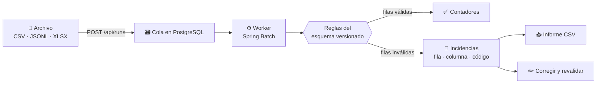

# 🧹 DataClean

**Valida CSV, JSONL y Excel contra esquemas versionados, por lotes y sin bloquear la API.**

Sube un archivo, obtén un identificador de ejecución y consulta en segundos cuántas filas son válidas, cuántas no y por qué. Después descarga el informe de incidencias o corrige las filas rechazadas y revalida.

   

---

## ⚡ Arranque rápido

Con Docker activo, desde la raíz del repositorio:

```sh
docker compose up --build -d
```

Abre **http://localhost:8080**. Eso es todo: la API, el panel Angular, PostgreSQL y un worker de validación arrancan juntos.

| ¿Qué quieres hacer? | Dónde |
| --- | --- |
| Usar la aplicación | http://localhost:8080 |
| Leer la API | [Contrato OpenAPI](src/main/resources/static/openapi.yaml) · `GET /openapi.yaml` |
| Ver la arquitectura | [docs/arquitectura.md](docs/arquitectura.md) |
| Ver rendimiento | [docs/rendimiento.md](docs/rendimiento.md) |

> ⚠️ **¿El puerto 8080 está ocupado?** Crea un archivo `.env` en la raíz con `DATACLEAN_PORT=8081` y abre http://localhost:8081.

---

## 🗺️ Cómo funciona



1. **Subes** un archivo con un esquema y una versión.
2. **Un worker** lo valida fila a fila con las reglas del esquema.
3. **Consultas** el estado, los contadores y las primeras incidencias.
4. **Descargas** el informe completo o corriges las filas rechazadas.

---

## 🖥️ Recorrido por la interfaz

La interfaz tiene cuatro secciones, accesibles desde la barra lateral:

| Sección | Para qué sirve |
| --- | --- |
| **Validar archivo** | Sube CSV, JSONL o XLSX, elige esquema y versión, y activa la conservación de filas. |
| **Resultados** | Procesadas, válidas e inválidas, primeras incidencias y descargas. Se recuerda al recargar la página. |
| **Historial** | Últimas 25 ejecuciones, con filtro por estado. Pulsa **Abrir** para volver a un resultado. |
| **Esquemas** | Crea versiones con el editor visual o el JSON, y consulta las existentes. |

### 1️⃣ Guarda un esquema

Ve a **Esquemas**, usa **Editar columnas visualmente** para definir tipos, obligatoriedad, unicidad, rangos, correo y valores predeterminados, y pulsa **Guardar versión**. Aparecerá en **Versiones registradas**.

> 💡 Las versiones son **inmutables**: volver a guardar la misma definición no hace nada, pero cambiarla exige una versión nueva.

### 2️⃣ Valida un archivo

En **Validar archivo** elige el esquema y la versión (o selecciónalos en **Versiones registradas**), sube el archivo y pulsa **Iniciar validación**. El formato se detecta por la extensión. En XLSX puedes indicar una hoja por nombre.

### 3️⃣ Lee el resultado

**Resultados** muestra tres contadores y una tabla con las primeras 20 incidencias:

| Fila | Columna | Código | Sugerencia |
| --- | --- | --- | --- |
| 2 | `id` | `TYPE` | — |
| 3 | `name` | `REQUIRED` | Completa el campo. |

Desde ahí puedes descargar el **CSV de incidencias** completo.

### 4️⃣ Corrige y revalida (opcional)

Si marcaste **Conservar filas para descarga durante 7 días**:

- Descarga las **filas válidas** y las **rechazadas** en JSONL.
- Pulsa **Editar valor** en una incidencia, elige una sugerencia o escribe el reemplazo y añádelo.
- Revisa la lista **Cambios para revalidar** y pulsa **Confirmar y revalidar**.

Se crea una ejecución vinculada con todas las filas revalidadas. Compara el recuento con el original y descarga el **archivo corregido**. Hasta 1.000 cambios por solicitud.

---

## 🧾 Reglas de validación

| Tipo | Admite | Ejemplo válido |
| --- | --- | --- |
| `STRING` | Cualquier texto; opcionalmente longitudes, valores permitidos y formato `EMAIL` | `Ana` |
| `INTEGER` | Enteros con signo | `-42` |
| `DECIMAL` | Decimales con punto, sin exponente | `3.14` |
| `DATE` | Fecha ISO `AAAA-MM-DD` | `2026-11-25` |
| `BOOLEAN` | `true` o `false` | `true` |

Reglas por columna:

- **`required`**: un campo obligatorio vacío genera `REQUIRED`. Uno opcional vacío pasa.
- **`min` / `max`**: límites inclusivos para `INTEGER` y `DECIMAL` (`MIN`, `MAX`).
- **`allowedValues`**: lista cerrada de valores (`NOT_ALLOWED`).
- **`minLength` / `maxLength`**: longitud en caracteres (`MIN_LENGTH`, `MAX_LENGTH`).
- **`format: "EMAIL"`**: sintaxis de correo en columnas `STRING` (`FORMAT`).
- **`unique: true`**: no admite repetidos dentro de la ejecución (`DUPLICATE`). Distingue mayúsculas y minúsculas.
- **`defaultValue`**: valor sugerido cuando falta un campo obligatorio.
- **`inputDecimalSeparator: ","`**: convierte `3,5` en `3.5` como sugerencia.

Se registra **el primer fallo** por campo, en este orden: tipo → longitud → valor permitido → formato → rango → unicidad. Una fila con un número incorrecto de campos genera `COLUMN_COUNT`.

Ejemplo de esquema:

```json
{
  "columns": [
    {"name": "email", "type": "STRING", "required": true, "format": "EMAIL", "unique": true},
    {"name": "age", "type": "INTEGER", "min": 18, "max": 100}
  ]
}
```

Límites: 100 columnas por esquema, 20 MiB por archivo.

---

## 📂 Formatos de entrada

| Formato | Cómo se lee | Ojo con… |
| --- | --- | --- |
| **CSV** | UTF-8 con o sin BOM; delimitador coma, punto y coma o tabulador | La cabecera debe tener **todas** las columnas del esquema, sin duplicados, en cualquier orden. |
| **JSONL** | Un objeto JSON por línea | Líneas vacías, claves repetidas o JSON mal formado **fallan la ejecución**. Las propiedades desconocidas generan `COLUMN_COUNT`. |
| **XLSX** | Fila 1 = nombres de columna; se lee la hoja indicada (o la primera) | Las **fórmulas** hacen fallar la ejecución: conviértelas en valores antes de subir. Las filas vacías se omiten. |

En Excel, las fechas nativas sin hora se convierten a `AAAA-MM-DD`, y los números y booleanos se leen como valores, sin importar el formato visual de la celda.

---

## 🧪 Prueba con los datos de ejemplo

El repositorio incluye un esquema y un archivo de muestra con errores intencionados:

1. En **Esquemas**, pega el contenido de [`examples/customers-v1.json`](examples/customers-v1.json) y guarda la versión `customers` v1.
2. En **Validar archivo**, sube [`examples/customers.csv`](examples/customers.csv) (o [`customers.jsonl`](examples/customers.jsonl)).

Resultado esperado:

| Procesadas | Válidas | Inválidas | Incidencias |
| :---: | :---: | :---: | :---: |
| 4 | 2 | 2 | 4 |

---

## 🧰 API con Postman

1. Importa la [colección de DataClean](postman/DataClean.postman_collection.json).
2. Define la carpeta del proyecto como [directorio de trabajo](https://learning.postman.com/latest-v-12/docs/getting-started/installation/settings/working-directory) de Postman.
3. En **3. Cargar archivo**, abre **Body → form-data** y selecciona [`examples/customers.csv`](examples/customers.csv) en el campo `file`. Confirma que `baseUrl` apunte a `http://localhost:8080` (o a tu puerto).
4. Pulsa **Run collection** con un retraso de 500 ms. La colección guarda el esquema, sube el archivo, espera a `COMPLETED` y comprueba informe, historial y vista previa.

Para JSONL, cambia `format` a `JSONL` y usa [`examples/customers.jsonl`](examples/customers.jsonl). Las aserciones de la colección esperan los datos de ejemplo.

El informe usa las columnas `row,column,code`. La fila 1 es el primer registro después de la cabecera.

---

## 🛠️ Desarrollo

**Requisitos:** JDK 27, Maven y Docker activo (los tests usan Testcontainers).

```sh
mvn verify
```

Para ejecutar la API fuera de Docker, apunta a un PostgreSQL con `DB_URL`, `DB_USER` y `DB_PASSWORD` y lanza `mvn spring-boot:run`. Valores por defecto: `jdbc:postgresql://localhost:5432/dataclean`, usuario y contraseña `dataclean`.

Para editar la interfaz con recarga en caliente, arranca la API en el puerto 8080 y luego, desde `frontend` (Node.js 24.15 o posterior de la rama 24):

```sh
npm ci
npm start
```

Abre http://localhost:4200. El servidor de desarrollo reenvía `/api` a Spring Boot.

---

## 📈 Salud y rendimiento

- `/actuator/health`: estado de la aplicación y sus dependencias.
- `/actuator/metrics/dataclean.queue.runs` y `/actuator/metrics/dataclean.queue.oldest.seconds`: tamaño y antigüedad de la cola por estado. Añade `?tag=state:QUEUED` o `?tag=state:RUNNING`.
- [Resultados de rendimiento y recuperación](docs/rendimiento.md) con un caso de 250.000 filas.

Benchmark sintético (mide latencia, espera, filas por segundo y heap):

```sh
node scripts/benchmark.mjs http://127.0.0.1:8080 250000
```

Prueba de recuperación en una instancia **desechable**: el tercer argumento interrumpe al worker que procesa el archivo y compara el SHA-256 del informe con una ejecución normal. Con dos workers, el otro retoma el trabajo mientras la API sigue disponible.

```powershell
$env:DATACLEAN_PORT='18084'
docker compose -p dataclean-bench-review up -d --build --scale worker=2
node scripts/benchmark.mjs http://127.0.0.1:18084 250000 dataclean-bench-review
docker compose -p dataclean-bench-review down -v
```

Para escalar workers: `docker compose up --build -d --scale worker=2`.

---

## 🩹 Problemas frecuentes

| Síntoma | Causa | Solución |
| --- | --- | --- |
| *"No se encontró el esquema o la versión"* | La versión que subes no está guardada. | Guárdala en **Esquemas** o elígela en **Versiones registradas**. Los nombres distinguen mayúsculas. |
| *"La versión ya existe con una definición diferente"* | Las versiones son inmutables. | Guarda la definición modificada con **otra versión** (p. ej. 2). |
| La página no carga en el puerto 8080 | Otro proceso ocupa el puerto. | Usa `DATACLEAN_PORT=8081` en `.env`. |
| Una ejecución queda en **Fallida** | El archivo no se puede leer o su cabecera no coincide. | Revisa el mensaje en **Resultados**. Falta una columna, la cabecera no coincide o el Excel tiene fórmulas. |
| No aparecen filas para descargar | No activaste **Conservar filas** o pasaron 7 días. | Vuelve a enviar el archivo con la opción activa. |

Para empezar de cero, borra la base de datos: `docker compose down -v`.

---

## 🧱 Stack técnico

| Componente | Versión |
| --- | --- |
| Java | 27 |
| Spring Boot | 4.2.0 |
| Spring Batch | 6.1.0 |
| PostgreSQL | 18.7 |
| Flyway | 13.13.0 |
| Testcontainers | 2.0.5 |
| Apache POI | 6.0.0 |
| Angular | 22.3.0 |
